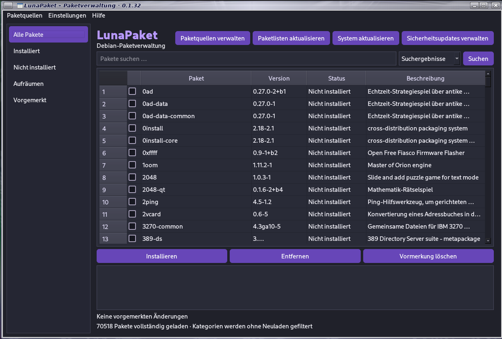

# LunaPaket 0.1.33

Grafische Paketverwaltung für Debian 13 (Trixie) und kompatible Debian-Systeme.
LunaPaket verwaltet APT-Pakete, Paketquellen und Sicherheitsupdates über eine
grafische Oberfläche auf Basis von Python 3 und PySide6.



[Github Seite](https://github.com/Angonikro/LunaPaket/)

## 1. Voraussetzungen

Empfohlen und getestet werden soll LunaPaket auf Debian 13 mit einer laufenden
grafischen Desktop-Sitzung (z. B. Raspberry Pi OS auf Debian-Basis, XFCE, GNOME
oder KDE).

Benötigt werden:

- Python 3
- PySide6 (Qt 6: Core, Gui und Widgets)
- Python-APT (`python3-apt`) für den Zugriff auf den APT-Paketkatalog
- APT und dpkg
- `pkexec` und ein laufender PolicyKit-Dienst für die Rechteabfrage
- die XCB-Bibliotheken für Qt auf X11

## 2. Abhängigkeiten installieren

Ein Terminal öffnen und ausführen:

```bash
sudo apt update
sudo apt install python3 python3-apt python3-pyside6.qtcore \
  python3-pyside6.qtgui python3-pyside6.qtwidgets \
  libxcb-cursor0 libxkbcommon-x11-0 libxcb-xinerama0 \
  apt dpkg pkexec polkitd desktop-file-utils shared-mime-info
```

Die Pakete entsprechen den Abhängigkeiten des mitgelieferten Debian-Pakets.
Auf einem System, auf dem einzelne Paketnamen nicht verfügbar sind, zuerst
prüfen, ob die Paketquellen für die verwendete Debian-Version vollständig
eingerichtet sind.

## 3. LunaPaket direkt aus der ZIP starten

Die ZIP-Datei zunächst in einen Ordner entpacken, zum Beispiel:

```bash
mkdir -p ~/Programme
unzip LunaPaket_0.1.33_GITHUB.zip -d ~/Programme
```

In den entpackten Projektordner wechseln:

```bash
cd ~/Programme/LunaPaket
```

Dann direkt mit Python starten:

```bash
python3 lunapaket/main.py
```

Alternativ liegt im Projektordner das Startskript `run.sh`. Es startet dieselbe
Anwendung aus dem entpackten Quellcode:

```bash
chmod +x run.sh
./run.sh
```

**Wichtig:** Für den Start aus der ZIP bitte `run.sh` oder
`python3 lunapaket/main.py` verwenden. Der Eintrag `lunapaket/lunapaket` ist
der System-Launcher für die installierte DEB-Version und verweist auf
`/usr/share/lunapaket/main.py`; er ist nicht der ZIP-Startbefehl.

LunaPaket fordert Administratorrechte bei Bedarf selbst über PolicyKit
(`pkexec`) an. Das Programm daher zunächst normal als Desktop-Benutzer starten,
nicht mit `sudo` ausführen. Die grafische Sitzung und die Einstellungen bleiben
so dem angemeldeten Benutzer zugeordnet.

## 4. Debian-Paket installieren

Wenn die DEB-Datei vorliegt, kann sie aus dem Download-Ordner installiert
werden. Beispiel:

```bash
cd ~/Downloads
sudo apt install ./LunaPaket_0.1.33_all.deb
```

Nach der Installation lässt sich LunaPaket über das Anwendungsmenü oder mit
folgendem Befehl starten:

```bash
lunapaket
```

Der Desktop-Eintrag registriert LunaPaket außerdem als Öffnen-mit-Anwendung
für Debian-Paketdateien (`.deb`).

## 5. Debian-Paket selbst aus dem ZIP bauen

Im entpackten Quellcode-Ordner:

```bash
cd ~/Programme/LunaPaket
chmod +x build_deb.sh
./build_deb.sh
```

Das Skript erstellt die Paketdatei im Unterordner `dist/`:

```text
dist/lunapaket_0.1.33_all.deb
```

Zum Bauen wird `dpkg-deb` benötigt (Paket `dpkg`). Die Laufzeit-Abhängigkeiten
werden in `debian/control` beschrieben.

## 6. Funktionen

- Paketübersicht mit installierten und nicht installierten Paketen
- Paketsuche und Paketdetails
- Pakete zur Installation oder Entfernung vormerken
- Systemaktualisierung und Aktualisierung der APT-Paketlisten
- Paketquellen (`sources.list`, `.list` und `.sources`) verwalten
- Sicherheitsupdates anzeigen und einzeln bearbeiten
- Sicherheitsupdates versionsbezogen zurückstellen und später reaktivieren
- automatische Sicherheitsupdate-Prüfung mit einstellbarem Intervall
- lokale DEB-Dateien über „Datei → DEB-Pakete öffnen …“ auswählen und installieren
- Dateimenü mit Anwenden vorgemerkter Änderungen, Paketlistenaktualisierung und Beenden
- Hauptoberfläche mit den Schaltflächen „Vormerkung löschen“ und „Vorgemerkte Änderungen anwenden“
- Installationen und Entfernungen über Kontrollkästchen vormerken und gemeinsam über APT ausführen; die Auswahl wird vor dem Anwenden nochmals mit dem Installationsstatus abgeglichen
- Paketquellen über das eigene Menü „Paketquellen“ verwalten; nicht über „Einstellungen“

Installationen und Änderungen am System werden über APT ausgeführt. Vor einer
Paketinstallation zeigt LunaPaket eine APT-Simulation an und verlangt eine
Bestätigung. Die automatische Sicherheitsupdate-Prüfung installiert keine
Pakete selbstständig.

## 7. Einstellungen und Daten

Die Einstellungen werden im Benutzerprofil gespeichert:

```text
~/.config/LunaPaket/LunaPaket.conf
```

Bei einem Start über `pkexec` verwendet LunaPaket weiterhin das Profil des
angemeldeten Desktop-Benutzers und nicht `/root`.

## 8. Fehlerbehebung

### „No module named PySide6“

PySide6 fehlt. Abhängigkeiten aus Abschnitt 2 installieren.

### „No module named apt“ oder Fehler beim Laden des Paketkatalogs

Python-APT fehlt oder passt nicht zur System-Python-Version:

```bash
sudo apt install python3-apt
```

### „pkexec“ fehlt oder es erscheint keine Rechteabfrage

PolicyKit-Komponenten installieren und prüfen:

```bash
sudo apt install pkexec polkitd
```

Die Anwendung aus der normalen Desktop-Sitzung starten. Nicht mit `sudo`
starten, sofern es nicht ausdrücklich zur Diagnose erforderlich ist.

### Qt-/XCB-Fehler beim Programmstart

Die XCB-Laufzeitbibliotheken installieren:

```bash
sudo apt install libxcb-cursor0 libxkbcommon-x11-0 libxcb-xinerama0
```

### Paketlisten lassen sich nicht aktualisieren

Die APT-Quellen und die Netzwerkverbindung prüfen. Die Paketlistenaktualisierung
benötigt Administratorrechte und eine erreichbare Paketquelle.

## 9. Deinstallation

Bei einer installierten DEB-Version:

```bash
sudo apt remove lunapaket
```

Für eine vollständige Entfernung einschließlich systemweiter Paketkonfiguration:

```bash
sudo apt purge lunapaket
```

Der entpackte ZIP-Ordner kann unabhängig davon einfach gelöscht werden.
Die persönlichen Einstellungen unter `~/.config/LunaPaket/` bleiben bei einer
normalen Deinstallation erhalten und können bei Bedarf separat entfernt werden.

## 10. Versionshinweis

Diese Dokumentation gehört zu LunaPaket **0.1.33**. Die Versionsnummer des
Programms und des Debian-Pakets wird durch diese README-Überarbeitung nicht
geändert.

73 de DO2QG Andreas
