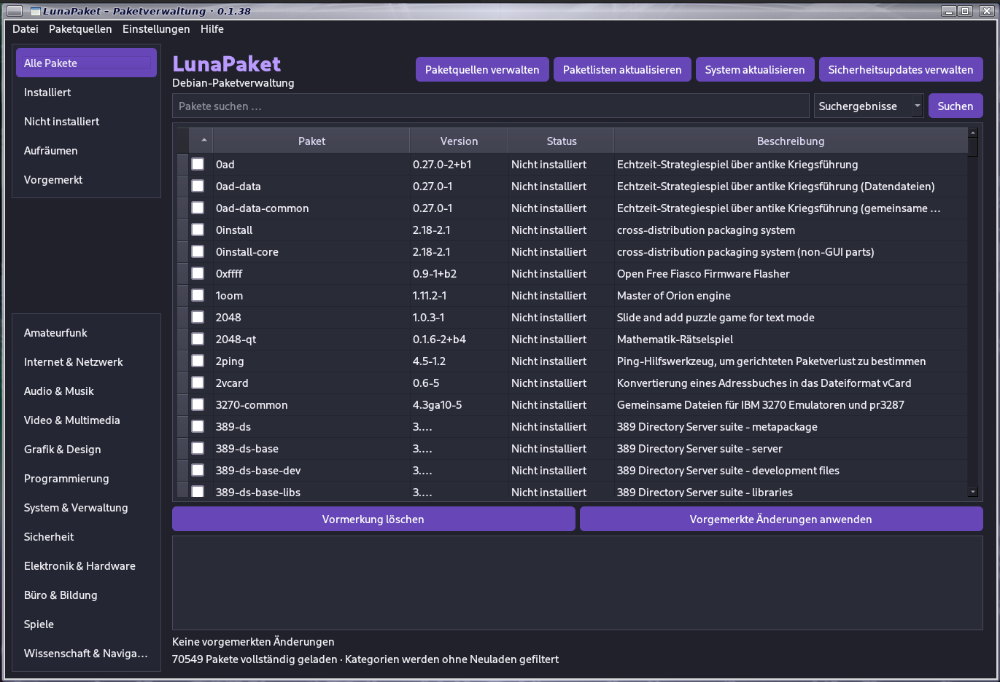

# LunaPaket 0.1.48 – APT, Flathub, Snap und AppImage

Grafische Paketverwaltung für Debian 13 (Trixie) und kompatible Debian-Systeme.
LunaPaket verwaltet APT-Pakete, Paketquellen und Sicherheitsupdates sowie Flatpak-Anwendungen aus Flathub und Snap-Anwendungen über eine
grafische Oberfläche auf Basis von Python 3 und PySide6.



[Github Seite](https://github.com/Angonikro/LunaPaket/)

## Funktionen

- Umschaltung zwischen APT-, Flathub- und Snap-Ansicht direkt in der Oberfläche
- Snap-Store-Suche mit Suchbegriffen und Store-Kategorien; Suchtreffer werden durch snapd passend zur Gerätearchitektur gefiltert
- Installierte und verfügbare Snaps unterscheiden
- Unter „Installiert“ System-Snaps und installierte Flatpak-Laufzeitumgebungen über „System-Apps anzeigen“ optional ein- und ausblenden; der lokale Paketbestand bleibt vollständig erhalten
- Snap-Kanäle Stable, Candidate, Beta und Edge getrennt nach `channel-map` der offiziellen Snapcraft-v2-API prüfen; ein Store-Metadatenabruf liefert die Releases aller vier Kanäle
- Ein gemeinsamer Snap-Master-Katalog je Gerätearchitektur lädt die Store-Kandidaten und die vollständige `channel-map` jedes Snaps einmalig (`~/.cache/LunaPaket/snap_catalog_store-master-<arch>.sqlite3`); Stable, Candidate, Beta und Edge werden daraus lokal abgeleitet und zusätzlich getrennt je Kanal gespeichert
- Die Kanal-Auswahl zeigt die Anzahl der Einträge im jeweils gespeicherten, channel-geprüften Katalog
- Ein Snap wird nur gezählt, wenn für den ausgewählten Track/Channel und die native Architektur ein veröffentlichter Release bestätigt wurde; installierte Snaps ohne Release in diesem Channel werden nicht künstlich ergänzt
- Snap-Anwendungsdetails mit Beschreibung, Herausgeber, Lizenz und Website, sofern vom Store-Suchergebnis geliefert
- Installierte Snaps zeigen ihren tatsächlich installierten Tracking-Kanal und die installierte Version unabhängig vom gerade ausgewählten Store-Kanal
- Installierte Snaps lassen sich per Rechtsklick direkt für einen Wechsel zwischen Stable, Candidate, Beta und Edge vormerken; LunaPaket verwendet dafür `snap refresh --channel=...`, ohne vorherige Deinstallation
- Snap-Kanalwechsel werden zusammen mit anderen vorgemerkten Snap-Aktionen ausgeführt und anschließend durch erneutes Einlesen von snapd überprüft
- Snaps installieren, entfernen und vorgemerkte Änderungen gemeinsam anwenden
- Verfügbare Snap-Updates suchen sowie ausgewählte oder alle Snaps aktualisieren
- Snap-Anwendungskatalog in einer lokalen SQLite-Datenbank speichern und bei fehlender Store-Verbindung offline anzeigen; Kategorieabfragen aktualisieren den Cache; Suchanfragen werden nicht in den gemeinsamen Katalogcache übernommen
- Flathub-Katalog mit installierten und verfügbaren Flatpak-Anwendungen
- App-Namen und App-Beschreibungen in Deutsch oder Englisch, sofern AppStream eine Übersetzung bereitstellt
- Flatpak-Anwendungen installieren und entfernen (benutzerspezifisch)
- App-Symbole aus dem lokalen Flatpak-Appstream-Cache, sofern vorhanden
- Thematische Softwarebereiche
- Paketübersicht mit installierten und nicht installierten Paketen
- Paketsuche und Paketdetails
- Pakete zur Installation oder Entfernung vormerken
- Installierte grafische Anwendungen direkt über das Kontextmenü starten (APT, Flathub und Snap)
- Systemaktualisierung und Aktualisierung der APT-Paketlisten
- Paketquellen verwalten
- Sicherheitsupdates anzeigen und einzeln bearbeiten
- Lokale DEB-Dateien auswählen und installieren
- AppImages nach `~/Applications` importieren, starten, im Anwendungsmenü registrieren und entfernen; LunaPaket erstellt beim Scan eigene, eindeutig benannte Starter und lässt fremde Starter unangetastet
- AppImages optional mit installiertem `AppImageUpdate` aktualisieren
- Konfigurierbarer Update-Wächter für APT, Flatpak und Snap mit Hintergrundprüfung und Benachrichtigung; es werden keine Updates automatisch installiert
- Gemeinsames Anwenden vorgemerkter Installationen und Entfernungen
- Paketverlauf für Installationen, Entfernungen und Aktualisierungen (aufrufbar über Datei-Menü, maximal 1 MB)
- Einstellbare Schriftgröße
- Oberflächensprache Deutsch/Englisch
- Hell-/Dunkel-Theme
- Deutsch/Englisch

## Einstellungen

Die Einstellungen werden im Benutzerprofil gespeichert:

```text
~/.config/LunaPaket/LunaPaket.conf
```

Dort speichert LunaPaket unter anderem Sprache, Farbschema, Schriftgröße
und Fensterposition. Auch bei einer Rechteabfrage über `pkexec` wird das
Profil des angemeldeten Desktop-Benutzers verwendet.

## Voraussetzungen

Empfohlen ist Debian 13 (Trixie) mit einer grafischen Desktop-Sitzung
(z. B. Raspberry Pi OS, XFCE, GNOME oder KDE).

Benötigt werden Python 3, PySide6, Python-APT (`python3-apt`), APT, dpkg,
PolicyKit (`pkexec` und `polkitd`) sowie die Qt-XCB-Laufzeitbibliotheken.

## Abhängigkeiten installieren

```bash
sudo apt update
sudo apt install python3 python3-apt python3-pyside6.qtcore \
  python3-pyside6.qtgui python3-pyside6.qtwidgets \
  libxcb-cursor0 libxkbcommon-x11-0 libxcb-xinerama0 \
  apt dpkg flatpak pkexec polkitd desktop-file-utils shared-mime-info libgtk-3-bin
```

Snap-Unterstützung ist optional. Für den Snap-Modus zusätzlich installieren:

```bash
sudo apt install snapd
```

Hinweis zum Snap-Modus: Die Store-Kandidaten und die vollständige `channel-map` jedes geprüften Snaps werden einmalig in einem gemeinsamen Master-Katalog je Gerätearchitektur gespeichert (`~/.cache/LunaPaket/snap_catalog_store-master-<arch>.sqlite3`). Beim Wechsel zwischen Stable, Candidate, Beta und Edge werden die jeweiligen Kanal-Kataloge lokal aus diesen Daten abgeleitet und separat gespeichert. Bereits geladene Store-Metadaten und Channel-Informationen werden dadurch nicht für jeden Kanal erneut heruntergeladen. Der Katalog umfasst die über Store-Suche, snapd-Kategorien und den ergänzenden Community-Katalog gefundenen Kandidaten; er ist kein offizieller vollständiger Export sämtlicher Snap-Store-Einträge. Screenshots und Store-Icons werden separat im Cache gespeichert, sofern der Store sie bereitstellt. Installation und Entfernung erfolgen weiterhin ausschließlich über snapd.

## LunaPaket direkt aus der ZIP starten

ZIP-Datei entpacken und in den Projektordner wechseln:

```bash
mkdir -p ~/Programme
unzip LunaPaket_0.1.48_GITHUB.zip -d ~/Programme
cd ~/Programme/LunaPaket
```

Start über das mitgelieferte Skript:

```bash
chmod +x run.sh
./run.sh
```

Alternativ:

```bash
python3 lunapaket/main.py
```

Für den ZIP-Start bitte `run.sh` oder `python3 lunapaket/main.py` verwenden.
Der Launcher `lunapaket/lunapaket` ist für die installierte DEB-Version
vorgesehen und verweist auf `/usr/share/lunapaket/main.py`.

Fehlgeschlagene APT-Befehle werden automatisch protokolliert. Das Fehlerprotokoll
liegt unter `~/.local/share/LunaPaket/logs/apt-errors.log`; bei Überschreiten
von 512 KB wird eine Sicherung (`apt-errors.log.1`) angelegt. Es werden nur
Fehler protokolliert, erfolgreiche Aktionen erzeugen keinen Logeintrag.

LunaPaket fordert Administratorrechte bei Bedarf über PolicyKit (`pkexec`) an.
Daher zunächst normal aus der grafischen Sitzung starten und nicht mit `sudo`.

## Debian-Paket installieren

```bash
cd ~/Downloads
sudo apt install ./lunapaket_0.1.48_all.deb
```

Anschließend über das Anwendungsmenü oder mit `lunapaket` starten.
Der Desktop-Eintrag registriert LunaPaket außerdem als Öffnen-mit-Anwendung
für Debian-Paketdateien (`.deb`).

## Debian-Paket selbst aus dem ZIP bauen

Im entpackten Projektordner:

```bash
cd ~/Programme/LunaPaket
chmod +x build_deb.sh
./build_deb.sh
```

Das Skript erstellt `dist/lunapaket_0.1.48_all.deb`.
Zum Bauen wird `dpkg-deb` benötigt.


## Fehlerbehebung

**PySide6 fehlt:**

```bash
sudo apt install python3-pyside6.qtcore python3-pyside6.qtgui python3-pyside6.qtwidgets
```

**Python-APT fehlt:**

```bash
sudo apt install python3-apt
```

**Keine PolicyKit-Rechteabfrage:**

```bash
sudo apt install pkexec polkitd
```

LunaPaket aus der normalen Desktop-Sitzung starten, nicht mit `sudo`.

## Deinstallation

```bash
sudo apt remove lunapaket
```

Für eine vollständige Entfernung einschließlich systemweiter Paketkonfiguration:

```bash
sudo apt purge lunapaket
```

Persönliche Einstellungen unter `~/.config/LunaPaket/` bleiben bei einer
normalen Deinstallation erhalten.

---

73 de DO2QG Andreas